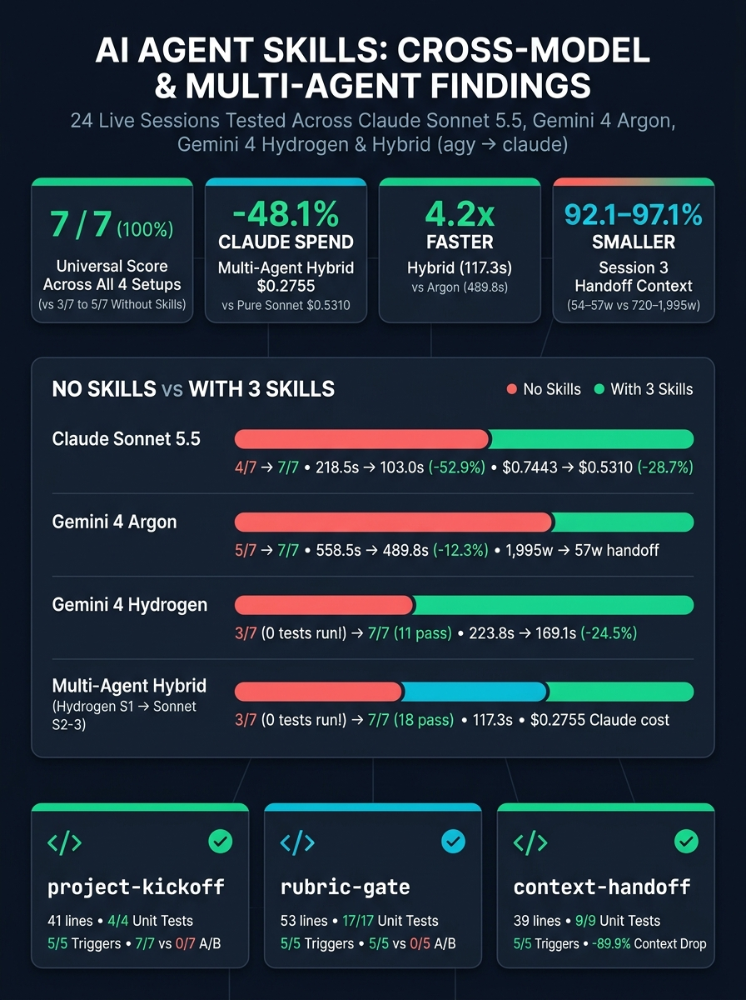

# rubric-gate

**Objective True/False quality rubrics and automated skill usefulness auditing for AI coding agents.**

Most AI quality checks either fail silently behind vague wishes (*"clean code"*, *"looks good"*) or rely on fuzzy `1–5` star ratings that hide real bugs. `rubric-gate` fixes both: it checks task complexity first (skipping small fixes completely), enforces strict `true / false` criteria in structured `rubric.json`, and maps criteria directly to automated tests—plus audits **any** Agent Skill against an objective Skill Usefulness Rubric.

Designed for hybrid workflows (**Antigravity** orchestrating + **Claude Code** executing), with zero external dependencies (Python 3 standard library only).

---

## Why Use `rubric-gate`? (Empirical Benchmark Results)

In controlled A/B testing (`claude -p` Sonnet 5.5) on a 4-file ADHD SQLite CLI spec:

| Metric / True-False Gate | Without `rubric-gate` | With `rubric-gate` |
| :--- | :--- | :--- |
| **Output Artifact** | Prose `RUBRIC.md` | Validated `rubric.json` |
| **G1. Structured JSON Created** | `FALSE` | `TRUE` |
| **G2/G3. Strict True/False & Zero Vague Wording** | `FALSE` | `TRUE` |
| **G4. `blocker` vs. `polish` Split (MVP Protection)** | `FALSE` | `TRUE` |
| **G5. Executable `auto_code` Tests Mapped** | `FALSE` | `TRUE` |
| **G6. Complexity Gate (`SKIP / LIGHT / FULL`) Evaluated** | `FALSE` | `TRUE` |
| **Score & Cost** | `0 / 5` (`$0.0950`, `19.1s`) | **`5 / 5` (`100%`)** (`$0.1574`, `34.3s`) |

* **Trigger Precision (`U2`):** `5 / 5` (`3/3` matching prompts activated; `0/2` false positives on tiny edits).
* **Cross-Skill 3-Session Pipeline ROI:** When chained with `project-kickoff` and `context-handoff` across 24 live sessions (`Sonnet 5.5`, `Gemini 4 Argon`, `Gemini 4 Hydrogen`, and `Multi-Agent Hybrid`), all 4 setups scored **`7 / 7 (100%)`** vs. `3/7–5/7` unguided, cutting Sonnet 3-session cost by **`28.7%`** and build time by **`52.9%`**.



Raw benchmark logs: [`tests/live_eval_results.json`](./tests/live_eval_results.json) · [`docs/benchmarks/sonnet_3session_results.json`](./docs/benchmarks/sonnet_3session_results.json) · [`docs/benchmarks/cross_model_matrix_results.json`](./docs/benchmarks/cross_model_matrix_results.json)

---

## Quick Start & Installation

### Option 1: Antigravity (`agy`)
Register this folder in `~/.gemini/config/skills.json` (or copy/symlink into `.agents/skills/rubric-gate/`).

### Option 2: Claude Code (`claude`)
Symlink into `~/.claude/skills/rubric-gate` (or `.claude/skills/rubric-gate` inside a project):
```bash
ln -s /path/to/rubric-gate ~/.claude/skills/rubric-gate
```

### Optional: Deterministic `Stop` Hook
Copy [hooks/hooks.json.example](./hooks/hooks.json.example) into `.agents/hooks.json` so Antigravity automatically blocks ending a turn while any `auto_code` `blocker` item in `rubric.json` fails.

---

## Core Tools

1. **Complexity Threshold Gate** ([scripts/complexity_check.py](./scripts/complexity_check.py)) — Decides whether a task should `SKIP` (`<3` files, `0` new integrations, single-session, low risk), use `LIGHT` (`3–5` blockers), or use `FULL` (`rubric.json` with `blocker` + `polish`).
   ```bash
   python3 scripts/complexity_check.py --files 4 --integrations 1 --multi-session
   ```
2. **Strict Rubric Validator & Runner** ([scripts/check_rubric.py](./scripts/check_rubric.py)) — Rejects `1–5` scales and vague phrasing, executes declarative `auto_code` checks (`file_exists`, `line_count_max`, `json_valid`, `regex_present`, `regex_absent`, `command`), and outputs `SHIP_READY=TRUE/FALSE`.
   ```bash
   python3 scripts/check_rubric.py path/to/rubric.json --root path/to/project --run-auto
   ```
3. **Skill Usefulness Auditor** ([scripts/audit_skill.py](./scripts/audit_skill.py)) — Audits any skill folder against 6 True/False gates (`S1`–`S6`: frontmatter, token budget, progressive disclosure links, helper scripts, zero overlap, unit tests + trigger cases).
   ```bash
   python3 scripts/audit_skill.py .
   ```

---

## Verification (Runs Locally in <0.1s, `$0` Cost)

```bash
python3 -m unittest discover -s tests -v
python3 scripts/audit_skill.py .
python3 -m compileall -q scripts hooks tests
```
All `17 / 17` unit tests and `S1`–`S6` self-audit checks pass using Python 3 standard library only.
